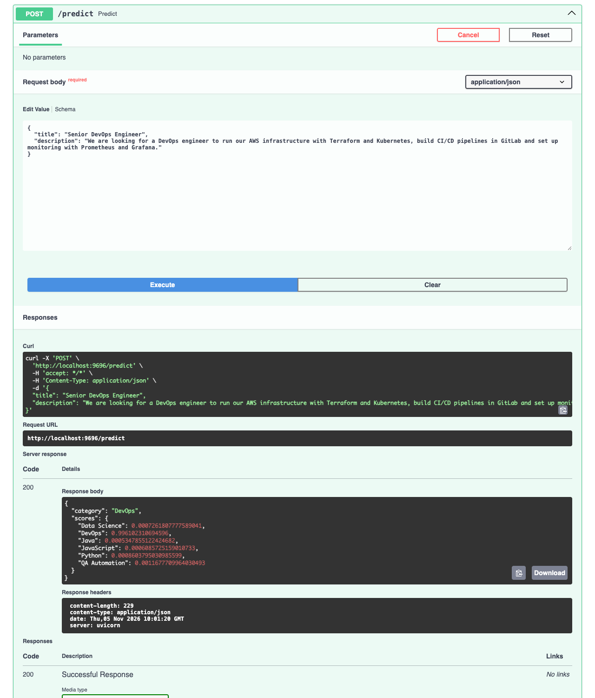

# Job Category Classifier

ML-project for ML Zoomcamp midterm. Given the job ad, try to determine to which of 6 job board categories this ad should be assigned.

## Problem description

On the job board, all the ads are grouped by categories (e.g. Java or DevOps) so the candidates could easily locate it. Someone has to define the category of each new job ad. When there are thousands of ads every month, it is a cumbersome process and could lead to the mistakes that prevent candidate from seeing the ad.

For this project we create model, which would read the title and text of the ad and suggest a category. An editor who reviews new ads can agree with the model's suggestion or change it. This model is designed solely for the job ad category assignment. The model does not assess candidates and is not involved in any hiring process.

## Data

The data used for the project is a public dataset of English job ads from the Djinni (job board for Ukrainian IT market) for the period from Jan 2020 to Sep 2023. It is hosted on Hugging Face under the name `lang-uk/recruitment-dataset-job-descriptions-english`. It contains 141 897 ads across 45 categories.

We use 6 biggest technical categories: JavaScript, Java, DevOps, QA Automation, Python, Data Science. It is 49 638 ads in total. The dataset is unbalanced. JavaScript has 17 903 ads. Data Science only has 2 262 ads.

Model makes prediction for column `Primary Keyword` which is a category that job board assigned. Only `Position` (ad title) and `Long Description` (text) from the ad are used.

## Getting the data

The data is not stored in this repository. Download the pinned version of the file (about 146 MB) into `data/raw/`:

```bash
mkdir -p data/raw
wget -O data/raw/djinni-jobs-en.parquet \
  https://huggingface.co/datasets/lang-uk/recruitment-dataset-job-descriptions-english/resolve/b56a6054c10f1266a141e37c8df66c79ff2863af/data/train-00000-of-00001.parquet
```

The link points to revision `b56a6054c10f1266a141e37c8df66c79ff2863af` of the dataset, so everyone gets the same file: 145,859,589 bytes, 141,897 rows and 10 columns. The dataset card lists the MIT license.

## Model evaluation

We use main metric - macro F1. We calculate F1 for each category and take the mean of 6 values. So the small category Data Science has the same weight as big category JavaScript. We split ads by company group so the model is always evaluated on the companies unseen during training. A company group joins the spellings of one company name and the companies whose ads start with the same text (e.g. an agency posting for a client). Groups are split 60/20/20 with `random_state=1`, which gives 34 039 training, 8 021 validation and 7 578 test ads.

## Restrictions

- model knows only about 6 categories. If the ad is in some different field, it is still assigned to one of these 6 categories.
- job board categories may overlap. E.g. sometimes Data Science ads contain data engineering jobs
- all ads are from Ukraine 2020-2023. The other markets/years could be different.

## EDA

The exploration in `notebook.ipynb` uses only the training set (34 039 ads).

- JavaScript is 34.5% of the training ads and Data Science 4.5%, so macro F1 is used instead of accuracy.
- The median length of the text (title plus description) ranges from 1 463 characters for JavaScript to 1 795 for Data Science. The lengths overlap almost completely, so length is not a feature.
- English level and experience carry little information about the category (mutual information 0.004 and 0.010), so the model uses only the text.
- Each category has its own characteristic words: `scientist` and `statistical` for Data Science, `django` and `celery` for Python, `selenium` and `webdriver` for QA Automation, `spring` and `hibernate` for Java, `puppet` and `sre` for DevOps.
- The categories overlap: 22% of the Data Science training ads have "data engineer" in the title.

## Model training

`CountVectorizer` with our own tokenizer marks which words each ad contains (lower case, with `+`, `#` and `.` kept, so `c++`, `c#` and `.net` survive), keeping only the words found in at least 5 ads of the fitting data. The vectorizer and the model form one scikit-learn pipeline.

The candidates are compared with 5-fold cross-validation over the company groups of the training set (`GroupKFold`, the same folds for every candidate, words refitted in each fold) and on the validation set. The baseline that always predicts JavaScript (`DummyClassifier`) has 0.093 validation macro F1.

| Model | CV macro F1 (mean ± std) | Validation macro F1 |
|---|---|---|
| Logistic regression, C=0.01, balanced class weights | 0.904 ± 0.007 | **0.914** |
| XGBoost, eta=0.1, 200 rounds | 0.905 ± 0.006 | 0.910 |
| Logistic regression, C=0.01 | 0.904 ± 0.007 | 0.905 |
| Logistic regression, C=1 | 0.881 ± 0.007 | 0.891 |
| Random forest, 200 trees, no depth limit | 0.879 ± 0.006 | 0.891 |
| Decision tree, max_depth=20, min_samples_leaf=20 | 0.834 ± 0.008 | 0.842 |

The notebook has all 25 tried configurations. Logistic regression with `C=0.01` and balanced class weights is chosen: it has the best validation macro F1 and it is simpler than XGBoost.

## Final model

The chosen model is trained again on training plus validation and evaluated once on the test set: **macro F1 0.9110, accuracy 0.9339**. The weakest categories are Python (F1 0.852) and Data Science (F1 0.816); on the validation set they are most often confused with each other.

## Project structure

```text
.
├── README.md
├── notebook.ipynb   # data preparation, EDA, model selection
├── features.py      # tokenizer shared by training and serving
├── train.py         # trains the final model and saves model.bin
├── model.bin        # trained pipeline: CountVectorizer and logistic regression
├── predict.py       # FastAPI prediction service
├── test.py          # sends one request to the service
├── Dockerfile
├── pyproject.toml
└── uv.lock
```

## Setup

Install [uv](https://docs.astral.sh/uv/), then install the dependencies and download the data (see [Getting the data](#getting-the-data)):

```bash
uv sync
```

`uv sync` creates the virtual environment in `.venv` with the exact versions from `uv.lock`. The commands below use `uv run`, which runs inside that environment; to activate it in your shell instead, run `source .venv/bin/activate`.

Run the notebook:

```bash
uv run jupyter notebook notebook.ipynb
```

Train the final model. It prints the test macro F1 and saves `model.bin` (takes about 15 seconds):

```bash
uv run python train.py
```

`model.bin` is committed, so the service and Docker image also work without the data.

## Prediction service

Start the service on port 9696:

```bash
uv run python predict.py
```

`POST /predict` takes the ad title and text, both non-empty, the title at most 300 characters and the text at most 20 000 characters; other input gets a 422 error. It returns the suggested category and the model's score for each of the six categories. `GET /health` returns `{"status": "ok"}`. The interactive documentation is at http://localhost:9696/docs.

```bash
curl -X POST http://localhost:9696/predict \
  -H 'Content-Type: application/json' \
  -d '{"title": "Senior Data Scientist", "description": "Build machine learning models with Python, pandas and scikit-learn; statistics and A/B testing."}'
```

```json
{"category":"Data Science","scores":{"Data Science":0.8320050299965877,"DevOps":0.0058805604577163665,"Java":0.003588906765664067,"JavaScript":0.0060361374460448656,"Python":0.13400473198196894,"QA Automation":0.018484633352018123}}
```

`test.py` sends another example:

```bash
uv run python test.py
```

## Docker

```bash
docker build -t job-category-classifier .
docker run -it --rm -p 9696:9696 job-category-classifier
```

Then call it from another terminal:

```bash
curl http://localhost:9696/health
uv run python test.py
```

## Deployment evidence

A real call to the service running in Docker (`docker run -p 9696:9696 job-category-classifier`), sent from its interactive documentation at http://localhost:9696/docs:



## Limitations

- The scores are the model's probabilities, not calibrated confidence. The service always picks one of the six categories, even for an ad from another field.
- Python and Data Science ads are the hardest to separate, partly because the job board's own labels overlap.
- The test set has companies unseen in training, but from the same years. Ads from later years are not evaluated.
